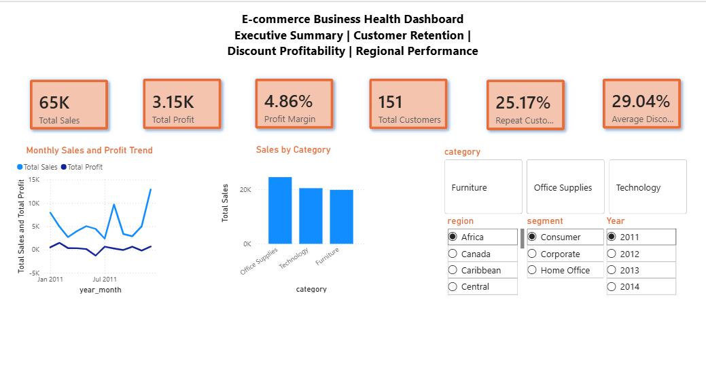
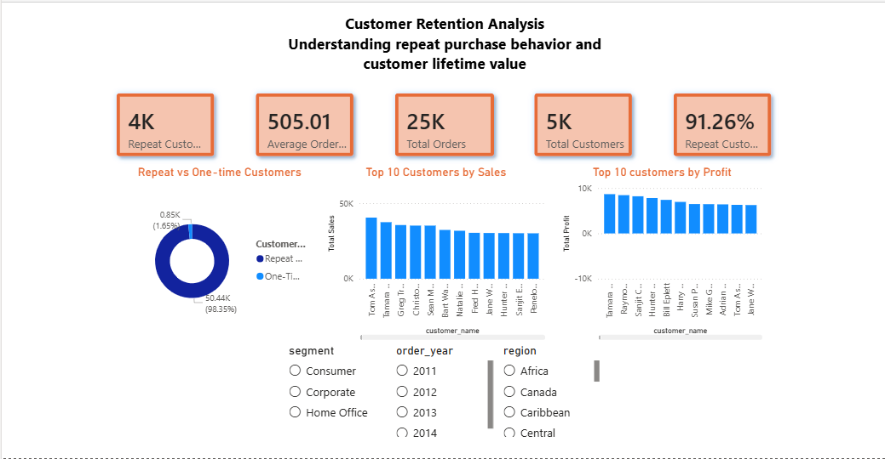
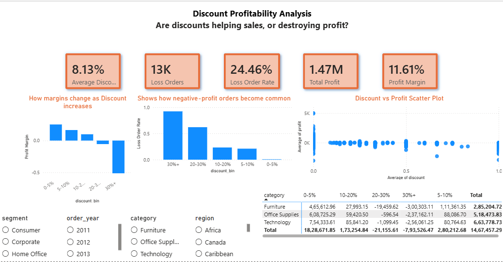
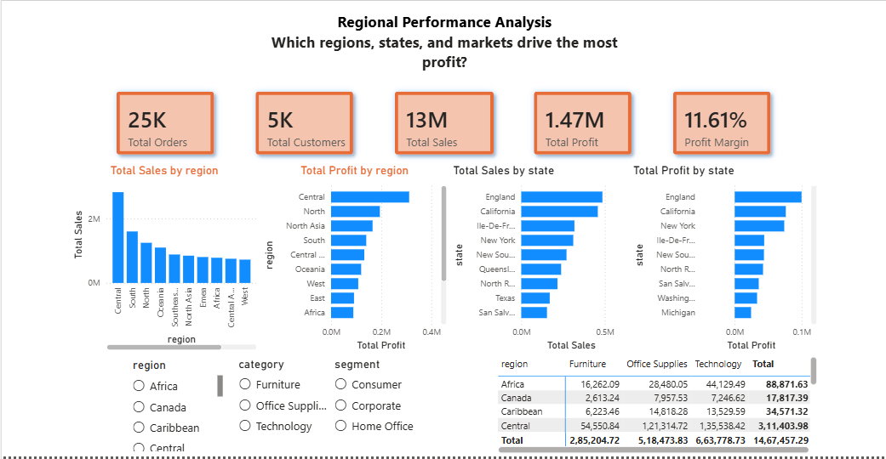

# E-commerce Business Health Analysis

An end-to-end business analytics project that analyzes customer retention, discount profitability, and regional performance using Python, SQL, and Power BI.

---

## 📌 Project Overview

This project explores a retail e-commerce dataset containing **51,290 transactions** and builds a complete analytics workflow:

- Data cleaning and preprocessing using Python
- Exploratory Data Analysis (EDA)
- Business KPI calculation
- SQL-based business queries
- Interactive Power BI dashboard
- Strategic business recommendations

The objective was to answer key business questions such as:

- Which customers are most valuable?
- How many customers return after their first purchase?
- At what discount levels does profitability deteriorate?
- Which regions and states drive the most profit?
- Which markets consistently underperform?

---

## 🎯 Business Objectives

### 1. Customer Retention Analysis

- Identify repeat vs one-time customers
- Measure repeat customer rate
- Find top customers by sales and profit
- Analyze segment-wise revenue contribution

### 2. Discount Profitability Analysis

- Measure the impact of discounts on profit margins
- Identify discount thresholds that create losses
- Calculate loss order rates by discount band
- Compare category profitability across discount levels

### 3. Regional Performance Analysis

- Compare sales and profit across regions
- Identify top and bottom performing states
- Analyze region-category profitability

---

## 📂 Dataset Information

- **Dataset:** Global Superstore Dataset
- **Rows:** 51,290
- **Columns:** 24+
- **Source:** Kaggle Global Superstore dataset

### Key Fields Used

- `order_id`
- `order_date`
- `customer_id`
- `customer_name`
- `segment`
- `category`
- `region`
- `state`
- `sales`
- `profit`
- `discount`

---

## 🛠️ Tech Stack

### Programming & Analytics

- Python
- Pandas
- NumPy
- Matplotlib
- Seaborn

### Business Intelligence

- Power BI
- DAX
- Power Query

### Database

- SQL

### Development Tools

- Jupyter Notebook
- VS Code
- Git
- GitHub

---

## 🧹 Data Cleaning & Feature Engineering

Performed the following preprocessing steps:

- Removed duplicates
- Standardized column names
- Converted date columns to datetime format
- Created derived features:
  - `profit_margin`
  - `order_year`
  - `order_month`
  - `discount_bin`
  - `is_loss_order`
  - `is_repeat_customer`
  - `customer_type`

---

## 📊 Exploratory Data Analysis

The notebook includes:

- Sales and profit trends over time
- Category and sub-category performance
- Customer retention analysis
- Discount threshold analysis
- Regional performance analysis
- Loss-making order analysis

---

## 🗃️ SQL Business Queries

The `sql/business_queries.sql` file contains SQL queries for:

- Overall business KPIs
- Category performance
- Top customers by sales and profit
- Discount impact analysis
- Regional profitability
- Bottom-performing states

---

## 📈 Power BI Dashboard

The project includes a four-page interactive dashboard.

### 1. Executive Summary

- KPI cards
- Monthly sales and profit trend
- Sales by category
- Profit by region
- Interactive slicers

### 2. Customer Retention Analysis

- Repeat vs one-time customer split
- Top customers by sales and profit
- Segment performance

### 3. Discount Profitability Analysis

- Profit margin by discount bin
- Loss order rate by discount bin
- Discount vs profit scatter plot
- Category vs discount matrix

### 4. Regional Performance Analysis

- Sales by region
- Profit by region
- Top 10 states by sales
- Top and bottom 10 states by profit
- Region vs category profit matrix

---

## 📸 Dashboard Screenshots

### Executive Summary



### Customer Retention Analysis



### Discount Profitability Analysis



### Regional Performance Analysis



---

## 🔍 Key Insights

### Customer Retention

- A significant proportion of customers were one-time buyers.
- A small subset of customers contributed a disproportionately large share of revenue.

### Discount Profitability

- Profit margins declined steadily as discount levels increased.
- Discounts above **30%** consistently resulted in substantial losses.

### Regional Performance

- Some regions generated strong sales but weak profitability.
- Several states were persistently loss-making despite high revenue.

---

## 💡 Business Recommendations

### Improve Customer Retention

- Launch loyalty and referral programs.
- Re-engage one-time buyers through targeted campaigns.

### Optimize Discount Strategy

- Limit discounts above 20–30%.
- Apply category-specific pricing rules.

### Strengthen Regional Strategy

- Investigate operational issues in low-profit states.
- Reallocate marketing budget toward higher-margin regions.

---

## 📁 Project Structure

```text
E_COMMERCE_ANALYSIS/
│
├── dashboard/
│   └── PowerBI_file.pbix
│
├── data/
│   └── processed/
│       └── superstore_cleaned.csv
│
├── images/
│   ├── Executive_Summary.png
│   ├── Customer_Retention_Analysis.png
│   ├── Discount_Profitability_Analysis.png
│   └── Regional_Performance_Analysis.png
│
├── notebooks/
│   └── ecommerce_analysis.ipynb
│
├── sql/
│   └── business_queries.sql
│
└── README.md